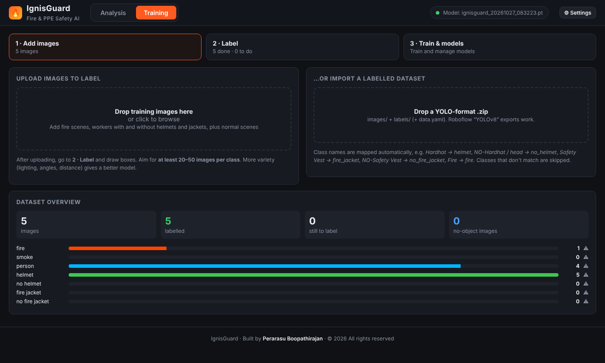
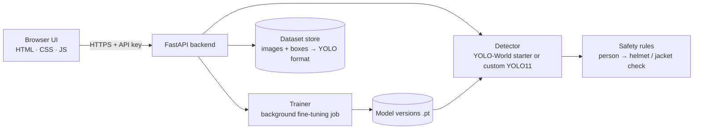

<div align="center">

# 🔥 IgnisGuard — Fire & PPE Safety AI

**Detects fire, smoke, missing helmets and missing fire jackets in images, video and webcam —
and lets you train your own detector in the browser.**

Created by **Perarasu Boopathirajan** · © 2026 · All rights reserved

</div>

---

## What it does

- **Hazard detection:** flags **fire** and **smoke** in photos, video files and live webcam feeds.
- **PPE compliance:** finds people and checks each one for a **helmet** and a **fire jacket**. A person without one becomes a `NO HELMET` / `NO FIRE JACKET` alert, via model detections plus a geometric head/torso rule.
- **Works on day one:** a zero-shot **YOLO-World** starter model detects the classes from text prompts before you have any training data.
- **Training studio in the browser:**
  1. Upload images, or import a labelled YOLO / Roboflow `.zip` (class names are mapped automatically).
  2. Draw boxes, or let the current model **auto-label** them for you to correct.
  3. Fine-tune **YOLO11 / YOLOv8** with a live loss and mAP chart, then activate the new model in one click.



## Architecture



| Part | Tech | Hosted on |
|---|---|---|
| `frontend/` | Vanilla HTML / CSS / JavaScript, canvas annotator | Netlify (static) |
| `backend/` | FastAPI, Ultralytics YOLO11 / YOLO-World, OpenCV, PyTorch (CPU) | Hugging Face Space (Docker) |

## Run it locally

```bash
cd backend
python -m venv .venv
# Windows: .venv\Scripts\activate    macOS/Linux: source .venv/bin/activate
pip install -r requirements.txt
python app.py          # opens the full app (UI + API) at http://127.0.0.1:8000
```

Model weights download automatically on first use.

## Deploy

See **[CONNECT-AND-TEST-GUIDE.md](CONNECT-AND-TEST-GUIDE.md)** for the step-by-step guide. In short, the backend runs as a Docker Space on Hugging Face and the frontend runs on Netlify with **Base directory** set to `frontend`. Set `IGNIS_API_KEY` on the Space and enter the same key in the UI under ⚙ Settings.

## Security

- **API key:** every `/api` call needs `IGNIS_API_KEY` when it's set, and the comparison is constant-time.
- **No model uploads without a key:** `.pt` files are Python pickles that can run code, so uploading them is **disabled unless a key is set**.
- **Safe file names:** model names are checked against a strict pattern, so `../` path tricks are blocked.
- **Upload limits:** size caps on images, zips and models, plus a zip-bomb guard on dataset import.
- **Training limits:** epochs, image size, batch size and device are validated.
- **XSS protection:** the UI escapes every server-supplied name before showing it (file names, class names, model names).
- **Responsive server:** heavy inference runs in worker threads so it doesn't block other requests.

## Author

**Perarasu Boopathirajan** — design, development and architecture.

## License

Copyright © 2026 Perarasu Boopathirajan. All rights reserved. See [LICENSE](LICENSE).
